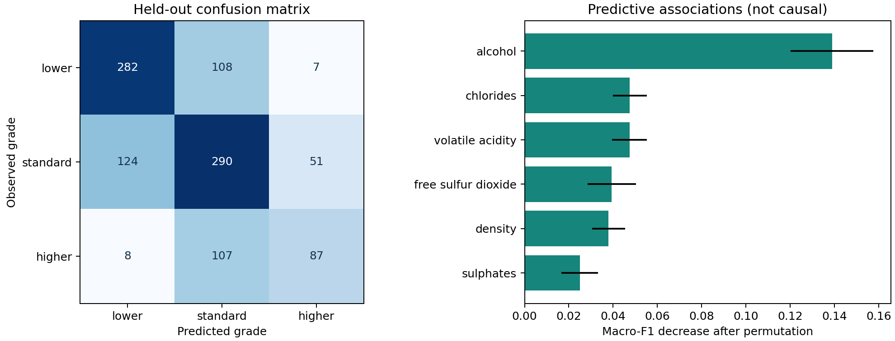

# AI-powered food quality analysis
## Predicting wine sensory quality from laboratory measurements

A reproducible research-preparation project using real public measurements, leakage-aware evaluation, and honest reporting. **This version predicts sensory quality bands; it does not detect spoilage, pathogens, toxins, or safety for consumption.** It is a tabular ML project, not an image model.

### Research question
Can physicochemical measurements predict lower, standard, and higher sensory-quality bands, and how much do nonlinear models improve over simple baselines on unseen measurement profiles?

### Measured results
Random forest was selected using four-fold training-only cross-validation. On 1,064 held-out unique profiles: accuracy **61.94%**, macro-F1 **0.5983**, balanced accuracy **0.5882**. The majority baseline achieves macro-F1 **0.2027**. The conditional bootstrap 95% interval for model macro-F1 is **0.5673–0.6293**. Higher-grade recall is only **43.07%**. These are benchmark results, not deployment validation.



### Run locally
Python 3.12 recommended (tested with 3.12.14). From this folder:
```bash
python -m venv .venv
# macOS/Linux:
source .venv/bin/activate
# Windows PowerShell instead: .venv\Scripts\Activate.ps1
pip install -r requirements.txt
python -m unittest discover -s tests -v
python src/food_quality.py train
python src/food_quality.py predict --input examples/measurements.csv --output results/example_predictions.csv
```
The public source archive and trained artifact are included, so training needs no data account or download. If the archive is missing, the script downloads it from UCI. Training is CPU-only and generally takes minutes; runtime varies. Dependencies are pinned to this run. Only load trusted joblib files. The example CSV contains held-out dataset rows, not new laboratory samples.

### What is included
- `src/food_quality.py`: data loading, validation, grouped split, four-model comparison, bootstrap, interpretation, saved model, prediction CLI.
- `docs/dataset_card.md`: provenance, features, units, license, labels, and audit.
- `docs/technical_report.md` and `.pdf`: short research report.
- `docs/research_plan.md`: defensible research positioning and next experiments.
- `results/metrics.json`: complete measured metrics and runtime versions.
- `results/test_predictions.csv`, `split_assignments.csv`: reproducible test evidence.
- `results/permutation_importance.csv`, `evaluation.png`: exploratory interpretation.
- `tests/` and `.github/workflows/tests.yml`: boundary, input validation, and split integrity checks.

### Method
Remove exact duplicate feature-plus-label rows before splitting; group identical input profiles, excluding target labels from grouping. Take the first fold of seeded five-fold stratified grouped splitting as a fixed ~20% test set. Select among four prespecified models by mean training-only four-fold macro-F1. Standardization is inside the logistic pipeline. Refit the winner on training data, evaluate once on test, and bootstrap test groups 1,000 times. Do not tune parameters using the published test results. No hyperparameter search or novel algorithm is claimed.

Grade boundaries are project-defined: score <=5 is `lower`, 6 is `standard`, >=7 is `higher`. They are not official grading standards. Macro-F1 weights all three classes equally. `ordinal_band_mae` uses band codes 0/1/2, not the original score scale. See the report for limitations.

### Input schema
Use exactly the 12 columns in `examples/measurements.csv`, comma-delimited. Eleven laboratory measurements retain UCI units; `wine_type` is 0=red and 1=white. Missing, nonnumeric, infinite values and invalid wine types are rejected. Out-of-training-range measurements are flagged but predictions still return; this is not a comprehensive distribution-shift detector. Predictions contain no calibrated probability or contamination risk.

## Repository and author

Maintained by Abass Ajagbe.

- GitHub: https://github.com/Abass69/food-quality-ml
- LinkedIn: https://www.linkedin.com/in/abass-ajagbe-70a8801b8/

Independent research-preparation prototype. The included results are benchmark results; real-world laboratory validation remains outstanding. See the technical report for methodology and limitations.

### Attribution and license
Code: MIT (`LICENSE`). Dataset: CC BY 4.0, separate from the code license. Cite Cortez, P., Cerdeira, A., Almeida, F., Matos, T., & Reis, J. (2009). *Wine Quality*. UCI Machine Learning Repository. https://doi.org/10.24432/C56S3T

Original study: Cortez et al. (2009), *Modeling wine preferences by data mining from physicochemical properties*, Decision Support Systems 47(4), 547–553. https://doi.org/10.1016/j.dss.2009.05.016
