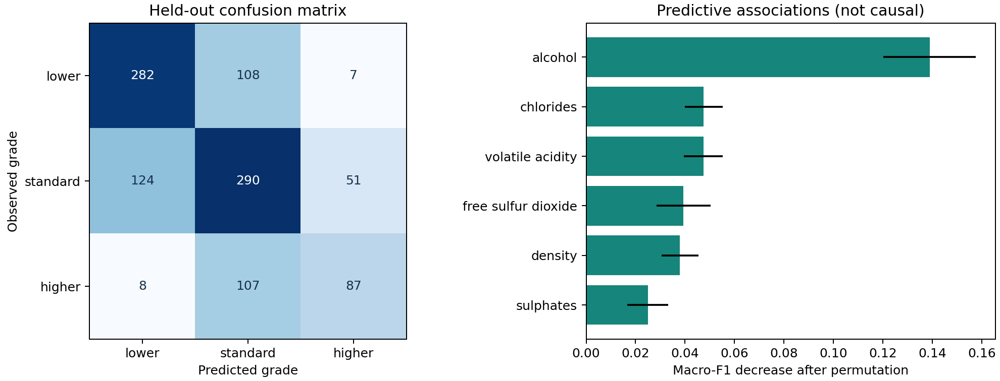

# AI-powered food quality analysis

Technical report | Reproducible benchmark | 15 November 2026

## 1. Objective and scope

Predict three sensory-quality bands from laboratory measurements of wine. The research question is whether nonlinear learners improve balanced classification over simple baselines on unseen measurement profiles. This is a research-preparation benchmark, not a new algorithm or a validated food safety system. No spoilage or contamination outcome is modelled.

## 2. Dataset and target

UCI Wine Quality [1] supplies 6,497 red and white Portuguese Vinho Verde records and 11 physicochemical inputs. Wine type is added from file identity. We remove 1,177 exact feature-plus-label duplicate rows, leaving 5,320 unique measurement profiles with no missing values. The target bands are project-defined: lower (score <=5; n=1,988), standard (6; n=2,323), and higher (>=7; n=1,009). These are not official grades. The archive, attribution, checksum and feature dictionary are included.

## 3. Experimental protocol

Seed 42 defines the first fold of a five-fold stratified grouped partition as test: 4,256 training and 1,064 test records. Groups are hashes of input measurements, including wine type and excluding quality. This prevents exact-profile overlap. Four-fold grouped cross-validation on training data selects the model with the highest mean macro-F1. Standardization is fitted inside each logistic-regression fold. No test-driven tuning is performed.

Prespecified candidates are a majority classifier, balanced logistic regression, a 300-tree random forest (minimum leaf size 2, square-root feature sampling, balanced subsample weights), and histogram gradient boosting (180 iterations, 15 leaves, L2=1). Full settings are in the source. The selected model is refitted on training data only. Test-group bootstrap resampling (1,000 replicates) estimates conditional uncertainty; it does not include training or model-selection uncertainty.

| Model | CV macro-F1 | Fold SD |
| --- | --- | --- |
| majority baseline | 0.2026 | 0.0001 |
| logistic regression | 0.5523 | 0.0041 |
| random forest | 0.5944 | 0.0065 |
| gradient boosting | 0.5807 | 0.0088 |

Primary metric: macro-F1, giving each band equal weight. Secondary metrics: accuracy, balanced accuracy and mean absolute error of band codes 0/1/2. Fold SD is descriptive, not a confidence interval.

## 4. Held-out performance

| Metric | Random forest | Majority baseline |
| --- | --- | --- |
| accuracy | 0.6194 | 0.4370 |
| balanced accuracy | 0.5882 | 0.3333 |
| macro f1 | 0.5983 | 0.2027 |
| ordinal band mae | 0.3947 | 0.5630 |

Test macro-F1 is 0.5983 (95% conditional bootstrap interval 0.5673-0.6293). This is an absolute improvement of 0.3955 over the baseline. Accuracy is 61.94%; balanced accuracy is 58.82%. Performance is useful as a baseline, but insufficient to justify autonomous grading.

| Grade | Precision | Recall | F1 | Support |
| --- | --- | --- | --- | --- |
| lower | 0.681 | 0.710 | 0.695 | 397 |
| standard | 0.574 | 0.624 | 0.598 | 465 |
| higher | 0.600 | 0.431 | 0.501 | 202 |

Higher-grade recall is 43.07%: 115 of 202 higher-grade samples are missed, including 107 classified as standard. Of 405 total errors, 15 cross both band boundaries. Red-wine macro-F1 is 0.5485 (271 test rows), versus 0.6036 for white wine (793 rows); this descriptive gap is not a significance claim. Permutation importance reports held-out predictive associations and is not used to tune the model. Correlated inputs can redistribute importance.

## 5. Reproducibility and verification

The package includes pinned dependencies, raw data, split assignments, all held-out predictions, metrics, trained model, a prediction CLI, and this report generator. Three automated tests passed: band boundaries, dataset/split integrity, and invalid-input handling. Training and prediction were executed in Python 3.12.14 with scikit-learn 1.8.0. The CI configuration is included but has not been executed on GitHub. Run python src/build_report.py after training to rebuild this report.

## 6. Limitations and interpretation

Endpoint validity: sensory preference is not spoilage or microbiological safety. No image, pathogen, toxin or shelf-life claims are supported. Analytical banding loses information and imposes arbitrary boundaries; an ordinal alternative is a future experiment.

Generalisation: this is one historical, regional wine dataset. There are no usable production-batch, winery or time identifiers in the pipeline. Deduplication prevents exact-copy leakage but cannot eliminate near-duplicate or hidden batch dependence. Removing duplicates also changes the evaluated population to unique profiles. Internal random holdout performance does not establish cross-region, cross-food or prospective performance.

Statistical uncertainty: only one outer holdout and a small fixed model set were used. The bootstrap is conditional on the chosen trained model and empirical test distribution. It does not measure uncertainty from retraining, unobserved batches or dataset shift. Label subjectivity and class imbalance limit attainable agreement; minority-grade recall remains weak.

Operational limits: predictions are class labels without calibrated confidence. Input validation checks column names, numeric finiteness and wine-type codes; a range flag detects only simple univariate departures from training. It cannot identify all unit mistakes, implausible combinations or distribution shifts. Human review and external validation are necessary for any operational use.

## 7. Research contribution and next study

The contribution is a transparent and auditable implementation of established methods, including duplicate-aware evaluation and class-specific error analysis. It demonstrates research preparation rather than methodological novelty. The code and documentation were prepared with AI assistance; the applicant should understand, verify and extend them, and follow any institutional disclosure policy.

Next, compare ordinal score models using training-only nested cross-validation; freeze the selected design before external testing. Obtain independent production batches with collection dates and repeated sensory labels. For a spoilage or contamination extension, first acquire appropriate laboratory-confirmed endpoints and sample identifiers, then use batch/time holdouts. Do not relabel sensory-quality scores as safety outcomes.

## References and licensing

[1] Cortez, P., Cerdeira, A., Almeida, F., Matos, T., and Reis, J. (2009). Wine Quality [Dataset]. UCI Machine Learning Repository. https://doi.org/10.24432/C56S3T. Dataset license: CC BY 4.0.

[2] Cortez et al. (2009). Modeling wine preferences by data mining from physicochemical properties. Decision Support Systems, 47(4), 547-553. https://doi.org/10.1016/j.dss.2009.05.016.

Code license: MIT. Original dataset authors retain their attribution. No new laboratory or field collection is claimed. Full provenance and unit conventions are in docs/dataset_card.md.
